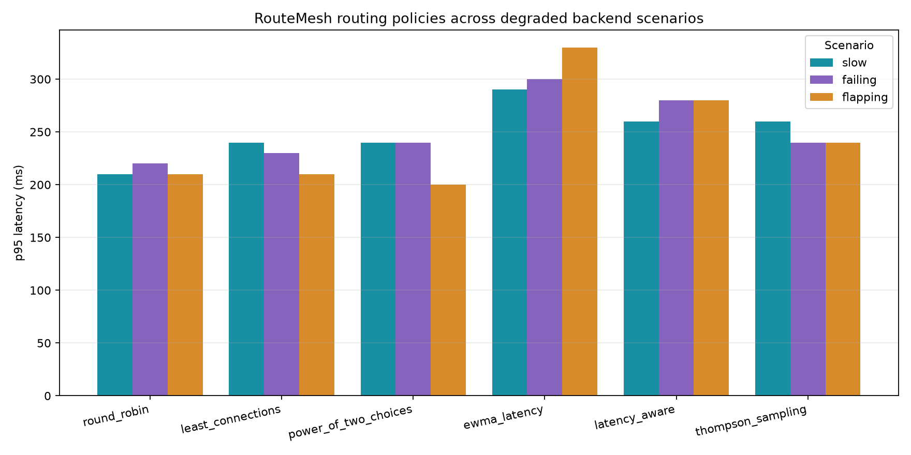
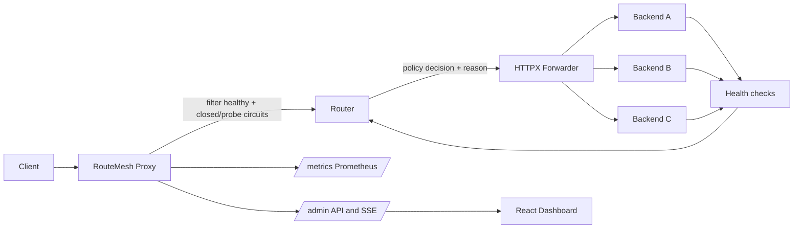

<p align="center">
  
</p>

<h1 align="center">RouteMesh</h1>

RouteMesh is an observable application-level reverse proxy. It selects a backend per request using health, circuit state, latency, CPU, errors, and in-flight work. It records why each selection happened and exposes metrics for policy comparisons.

## Measured policy comparison



This quick local comparison uses 30 users, a 5 users/second ramp, and 10 seconds per policy/scenario on Windows 11. It is a short smoke benchmark, not a stable production capacity claim. See [the complete measured table and conditions](docs/benchmarks/results.md); rerun with the default 60-second samples using `make bench`.

The displayed error rate is the final client-visible HTTP failure rate after retries; it is not the backend attempt error rate.

## Learning guide

See [the architecture guide](docs/architecture.md) for request flow, system boundaries, and design trade-offs, and [the threat model](docs/THREAT_MODEL.md) for admin controls and deployment limits.

## How it works

RouteMesh filters out unhealthy or circuit-open backends, applies the selected routing policy to the remaining candidates, and forwards the request with a recorded selection reason.


The demo compares round-robin, least-connections, power-of-two choices, EWMA latency, scored routing, and contextual Thompson sampling. The bandit uses an experimental in-memory reward model; it is not a production benchmark or distributed control plane.

## Quick start

Requirements: Docker Desktop with its engine running. The same commands work on Windows, macOS, and Linux.

1. Copy `.env.example` to `.env` (`Copy-Item .env.example .env` in PowerShell; `cp .env.example .env` in macOS/Linux shells). Set `ROUTEMESH_ADMIN_TOKEN` to a private value of at least 32 characters. Generate one with `python -c "import secrets; print(secrets.token_urlsafe(32))"`. The app refuses to start with a missing, short, or example token; `.env` is ignored by Git.
2. Start the demo: `docker compose up --build`.
3. Open the dashboard at http://localhost:3000; proxy API docs are at http://localhost:8000/docs.

The stack starts one proxy, three controllable FastAPI backends, Prometheus, and the dashboard. Stop with `docker compose down`. Use `make bench` for the default 60-second comparison samples; the chart above is labeled with the shorter measured smoke-run conditions.

## Request flow



## Structure

- `src/routemesh/proxy`: FastAPI app, catch-all proxy route, router, forwarder, backpressure, admin API.
- `src/routemesh/policies`: isolated round-robin, least-connections, power-of-two, EWMA latency, scored, and contextual bandit strategies.
- `src/routemesh/discovery`: validated YAML and backend state registry.
- `src/routemesh/health`: active checks and circuit breaker.
- `src/routemesh/metrics`: Prometheus instruments, EWMA, rolling windows, decisions, SSE fanout.
- `src/routemesh/test_backends`: demo-only controllable backends.
- `src/routemesh/benchmarks`: Locust workload and report tooling.
- `dashboard`: strict TypeScript React operations UI, bundled with Vite and served as static assets.
- `tests`: deterministic unit tests and forwarding integration tests.
- `configs`: routing and Prometheus settings.
- `docs`: architecture, trade-offs, and benchmark methodology.

## Try the routing controls

Use the dashboard to switch policy or make one backend slow, failing, or unavailable. Send traffic through the proxy, for example:

```powershell
1..50 | ForEach-Object { Invoke-WebRequest -Uri http://localhost:8000/demo -Method GET }
```

The decision feed shows the chosen backend and reason. Metrics are at http://localhost:8000/metrics and Prometheus at http://localhost:9090.

## Development

- `make install`: install package and development tools.
- `make lint`: Ruff lint.
- `make format`: Ruff formatter.
- `make typecheck`: strict mypy.
- `make test`: pytest.
- `make check`: lint, type check, and tests.
- `make bench`: run identical 60-second Locust samples for each policy against slow, failing, and flapping backends. It creates raw CSV, JSON, and a p95 chart in `output/benchmarks`.

Configuration is validated from `configs/routemesh.yaml`; `ROUTEMESH_CONFIG_PATH` selects another file. Environment variables use the `ROUTEMESH_` prefix. All admin mutations require `X-RouteMesh-Admin-Token`; without a strong configured `ROUTEMESH_ADMIN_TOKEN`, app creation fails closed.

## Reliability and limits

Retries are limited to GET, HEAD, OPTIONS, PUT, DELETE, or requests with an Idempotency-Key, and share a configurable global retry budget. Request bodies are bounded by `ROUTEMESH_MAX_BODY_BYTES`. Hop-by-hop headers are removed. The proxy currently buffers bounded bodies; large streaming uploads, TLS termination, HTTP/2, WebSocket proxying, slow-start, and dynamic service discovery are not implemented in this phase. Admins can start a graceful drain with `POST /admin/backends/{id}/drain`, poll `/admin/backends` until `in_flight` reaches zero, then remove the service from configuration; `POST /admin/backends/{id}/resume` restores routing. Circuit re-admission uses capped exponential backoff.

Latency-aware scoring uses normalized EWMA latency, reported CPU, rolling error rate, and a small in-flight penalty. It is an explicit heuristic. Thompson sampling is a separate experimental contextual policy using a bounded latency/error reward and exponential forgetting; its posterior is process-local and has not been shown to adapt faster in an end-to-end changing-backend benchmark. The registry, breakers, and decision stream are also process-local; use one proxy replica for this demo. PostgreSQL, a distributed control plane, and production-grade throughput are intentionally out of scope.


