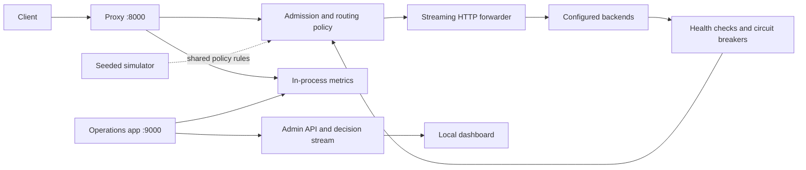

<p align="center"></p>

<h1 align="center">RouteMesh</h1>

<p align="center">An observable application-level reverse proxy with explainable routing decisions and bounded resilience controls.</p>

<p align="center">
  <a href="https://github.com/nihalmachhi/RouteMesh/actions/workflows/ci.yml"></a>
  <a href="LICENSE"></a>
  
</p>

RouteMesh routes requests to configured healthy backends, records why it chose them, and exposes operational controls on a separate, authenticated port. The proxy is designed as a lab and learning project, not a production service mesh.

## Quick start

Requirements: Docker Desktop with its Linux engine running.

```powershell
Copy-Item .env.example .env
# Replace ROUTEMESH_ADMIN_TOKEN in .env with a long random secret.
docker compose up --build
```

- Proxy data port: `http://localhost:8000`
- Operations API and Prometheus metrics: `http://127.0.0.1:9000` (send `X-RouteMesh-Admin-Token`)
- Prometheus: `http://127.0.0.1:9090`
- Interactive site: [nihalmachhi.github.io/RouteMesh](https://nihalmachhi.github.io/RouteMesh/)

Compose publishes the operations port only on host loopback. The proxy data port does not reserve `/admin`, `/metrics`, `/healthz`, or `/docs`; those paths are not part of its API. The project has no built-in Swagger docs.

## Claims → proof

| Claim | Evidence |
| --- | --- |
| Compressed response bytes and repeated headers are preserved | `tests/integration/test_forwarder_integration.py` |
| Uploads and downloads stream; oversized requests are rejected while reading | `tests/integration/test_forwarder_integration.py` |
| Retry credit expires with an injected clock | `tests/unit/test_retry_budget.py` |
| Operations routes fail closed and use a distinct listener | `tests/integration/test_admin_routes.py` |
| Python and browser policy/simulator outputs agree on seeded fixtures | `site/src/features/simulator/engine.test.ts` |
| Policy, tuning, and service-graph reports are reproducible | `make reproduce`; generated JSON in `benchmarks/results/` and `site/src/data/` |

Simulator output is generated from synthetic backend signals. It illustrates relative behavior under the model; it is not a real throughput or production latency measurement. Run `make bench` against the local Compose stack for machine-specific Locust measurements.

## Request path



## Development

```sh
uv sync --all-extras
uv run ruff check .
uv run ruff format --check .
uv run mypy src
uv run pytest -q --cov=routemesh --cov-fail-under=85
make reproduce
```

The proxy only forwards to upstreams in `configs/routemesh.yaml`; client input cannot select a backend URL. Configure `ROUTEMESH_ADMIN_TOKEN` before using admin or metrics routes. Locally the operations listener binds to `127.0.0.1`; Compose binds inside its private network and publishes host access on `127.0.0.1:9000`.

## Boundaries

RouteMesh is a single-process learning proxy with static backend configuration and in-memory state. WebSocket proxying, TLS termination, multi-process control-plane state, and dynamic cloud service discovery are outside its scope. Computer vision is intentionally excluded because this project has no image input or vision problem.

See [architecture](docs/architecture.md), [policies](docs/policies.md), [simulator methodology](docs/simulator.md), [benchmark methodology](docs/benchmarks.md), and [security boundaries](docs/threat-model.md). Licensed under [MIT](LICENSE).
