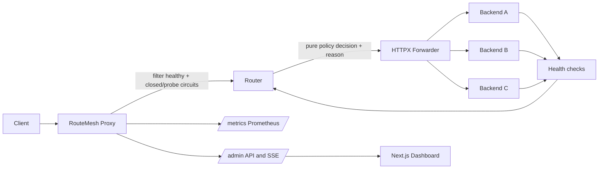

# RouteMesh

RouteMesh is an observable application-level reverse proxy. It selects a backend per request using health, circuit state, latency, CPU, errors, and in-flight work. It records why each selection happened and exposes metrics for policy comparisons.

## Learning guide`n`nSee [RouteMesh_How_It_Works.pdf](docs/RouteMesh_How_It_Works.pdf) for the request-flow diagram, folder guide, run steps, and troubleshooting notes.`n`n## Quick start

Requirements: Docker Desktop with its engine running.

1. Copy the local environment template: `Copy-Item .env.example .env` (PowerShell).
2. Start the demo: `docker compose up --build`.
3. Open the dashboard at http://localhost:3000; proxy API docs are at http://localhost:8000/docs.

The stack starts one proxy, three controllable FastAPI backends, Prometheus, and the dashboard. Stop with `docker compose down`. No benchmark numbers are checked in as if measured; use `make bench` to create a local run.

## Request flow



## Structure

- `src/routemesh/proxy`: FastAPI app, catch-all proxy route, router, forwarder, backpressure, admin API.
- `src/routemesh/policies`: pure round-robin, least-connections, and latency-aware strategies.
- `src/routemesh/discovery`: validated YAML and backend state registry.
- `src/routemesh/health`: active checks and circuit breaker.
- `src/routemesh/metrics`: Prometheus instruments, EWMA, rolling windows, decisions, SSE fanout.
- `src/routemesh/test_backends`: demo-only controllable backends.
- `src/routemesh/benchmarks`: Locust workload and report tooling.
- `dashboard`: strict TypeScript operations UI.
- `tests`: deterministic unit tests and forwarding integration tests.
- `configs`: routing and Prometheus settings.
- `docs`: architecture, trade-offs, and benchmark methodology.

## Try the routing controls

Use the dashboard to switch policy or make one backend slow, failing, or unavailable. Send traffic through the proxy, for example:

```powershell
1..50 | ForEach-Object { Invoke-WebRequest -Uri http://localhost:8000/demo -Method GET }
```

The decision feed shows the chosen backend and reason. Metrics are at http://localhost:8000/metrics and Prometheus at http://localhost:9090.

## Development

- `make install`: install package and development tools.
- `make lint`: Ruff lint.
- `make format`: Ruff formatter.
- `make typecheck`: strict mypy.
- `make test`: pytest.
- `make check`: lint, type check, and tests.
- `make bench`: run identical 60-second Locust samples for each policy and create raw CSV, JSON, and a p95 chart in `output/benchmarks`.

Configuration is validated from `configs/routemesh.yaml`; `ROUTEMESH_CONFIG_PATH` selects another file. Environment variables use the `ROUTEMESH_` prefix. Configure `ROUTEMESH_ADMIN_TOKEN` outside local demo use to protect policy and backend behavior changes.

## Reliability and limits

Retries are limited to GET, HEAD, OPTIONS, PUT, DELETE, or requests with an Idempotency-Key, and share a configurable global retry budget. Request bodies are bounded by `ROUTEMESH_MAX_BODY_BYTES`. Hop-by-hop headers are removed. The v1 path buffers bounded bodies; large streaming uploads, TLS termination, HTTP/2, WebSocket proxying, and dynamic cloud discovery are out of scope.

Latency-aware scoring uses normalized EWMA latency, reported CPU, rolling error rate, and a small in-flight penalty. A score is an explicit heuristic, not machine learning. The in-memory registry and decision stream are process-local; use one proxy replica for this demo. PostgreSQL, a distributed control plane, and production-grade throughput are intentionally out of scope.
