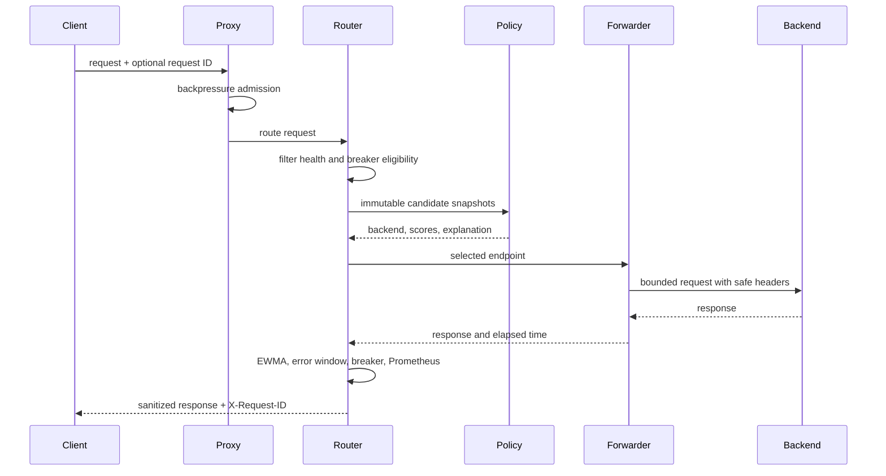
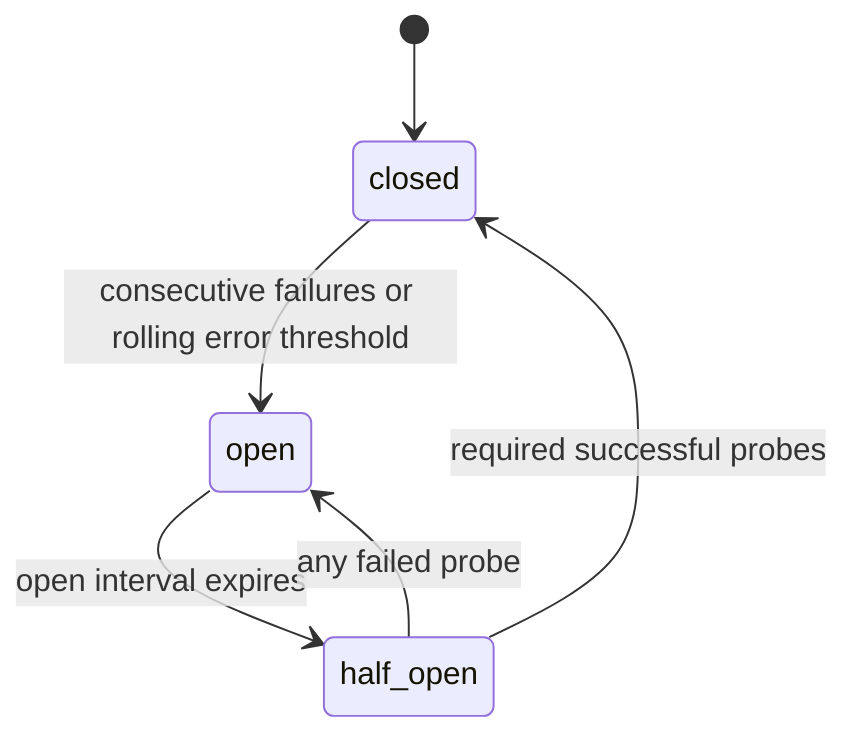

# Architecture and request lifecycle

The proxy app creates one shared HTTPX AsyncClient during lifespan and closes it on shutdown. It loads and validates YAML before serving. The backend registry owns mutable snapshots; policies receive detached copies and return immutable decisions. The router alone decides eligibility and retries. The forwarder only translates HTTP requests and responses.

## Failure flow

Active health checks use configurable consecutive failure and recovery thresholds. Circuit breakers track request outcomes separately. If every backend is unhealthy or circuit-ineligible, the proxy returns 503 with Retry-After. A forward timeout maps to 504; a connection failure maps to 502.

## Routing policies

- Round robin rotates the healthy candidate set with a router-owned counter.
- Least connections minimizes current in-flight requests.
- Latency-aware min-max normalizes EWMA latency, CPU, and error rate among current candidates; lowest weighted score wins. A small normalized in-flight penalty and stable tie-break limit herding.

The policies contain no network calls or global mutable state. Request/error metrics use only backend, policy, and status class labels. Request IDs appear in decision logs and admin data, never as metric labels.

## Boundaries

Static YAML is the service registry. Health checks update live health; the breaker consumes request outcomes. Test backends and their behavior controls exist for local experiments only. Admin SSE is best-effort and bounded; polling the admin API recovers current state after reconnect.
